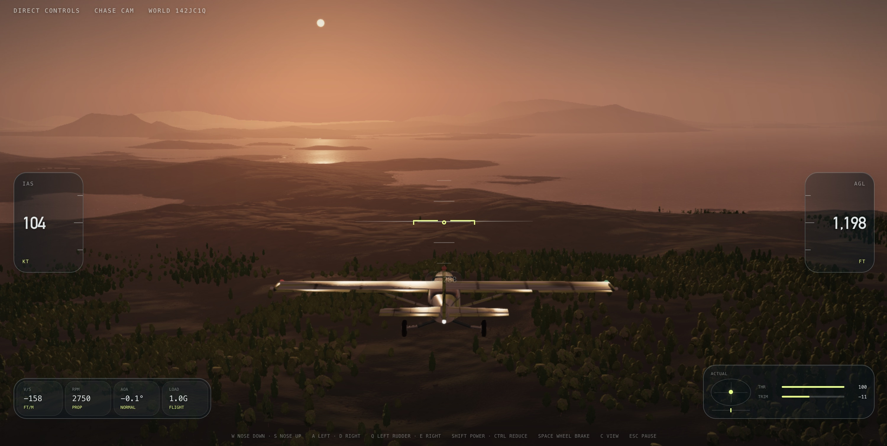

# fly high



Built with TypeScript, React, and Babylon.js on WebGPU.

## Requirements

- Node.js 22.13 or newer
- A current desktop browser with WebGPU support
- A hardware GPU. Software rendering is not supported.

## Run it

```bash
npm ci
npm run dev
```

Open [http://localhost:3000](http://localhost:3000) and press **Start**.

## Controls

| Key | Action |
| --- | --- |
| `W` / `S` | Nose down / nose up |
| `A` / `D` | Bank left / bank right |
| `Q` / `E` | Rudder left / rudder right |
| `+` / `−` (or `Shift` / `Ctrl`) | Throttle up / down |
| `F` / `V` | Extend / retract flaps |
| `↑` / `↓` | Elevator trim |
| `Space` | Wheel brakes |
| `C` | Cycle camera: chase, cockpit, orbit, top, front |
| `H` | Cycle HUD |
| `N` | Show / hide the nearest airport |
| `L` | Autoland at the nearest airport (press again, or move the stick hard, to take back control) |
| `R` | Restart |
| `Esc` or `P` | Pause / resume |

Fly 14 km from every airport and a new one is built 5 to 9 km away, so there is always somewhere to land; the nearest-airport marker (or the button at the top right of the HUD) points to whichever is closest.

Autoland (`L`, or the button beside it) flies the aeroplane you are in to the nearest airport and lands it: it plans a circuit to whichever runway end it can reach, flies the approach and flare inside the aircraft's own limits, and brakes to a stop on the runway. When an approach cannot end in a landing (too high, too fast, off the centreline, or a downdraft on short final) it goes around and tries again. Once stopped it holds the brakes until you press `L` again or move the stick.

Gamepads and joysticks are supported too. Sensitivity, dead zone, pitch inversion, and mouse flight can be changed in settings.

## Test and build

```bash
npm run verify        # lint, typecheck, tests, and production build
npm test              # deterministic test suite
npm run test:gpu      # WebGPU tests (needs a real GPU)
npm run perf:capture  # screenshot and frame-time capture suite
npm run build         # production bundle (Cloudflare Worker)
npm run build:pages   # static bundle for GitHub Pages
```

## Documentation

- [docs/FLIGHT_MODEL.md](docs/FLIGHT_MODEL.md), [docs/CALIBRATION.md](docs/CALIBRATION.md), [docs/PERFORMANCE.md](docs/PERFORMANCE.md): how the aircraft, its calibration, and the performance budgets work.
- [docs/architecture/](docs/architecture/): the architecture contract the code must satisfy.
- [docs/plans/](docs/plans/): the rendering programme and each phase's execution plan.
- [docs/findings/](docs/findings/): audits, measured defects, and review briefs.
- [docs/status/](docs/status/): closeout, handover, and outcome records. Start with [PROJECT_CLOSEOUT_2026_09_02.md](docs/status/PROJECT_CLOSEOUT_2026_09_02.md).

## License

[Apache License 2.0](LICENSE)
